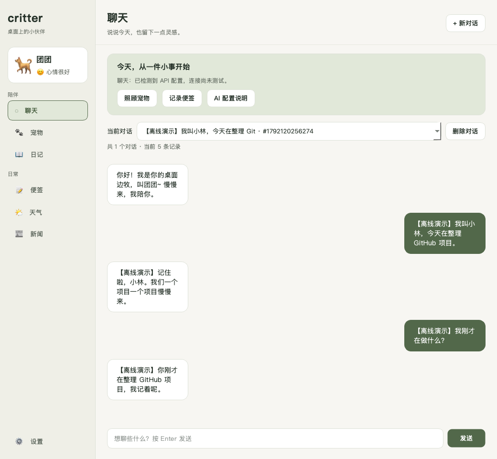
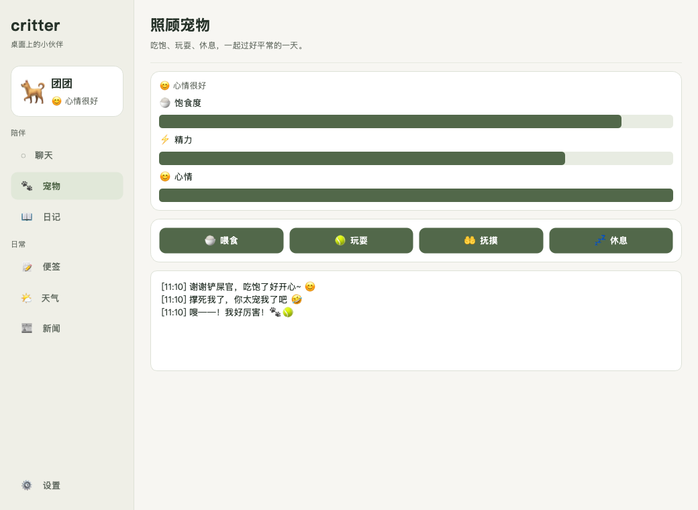
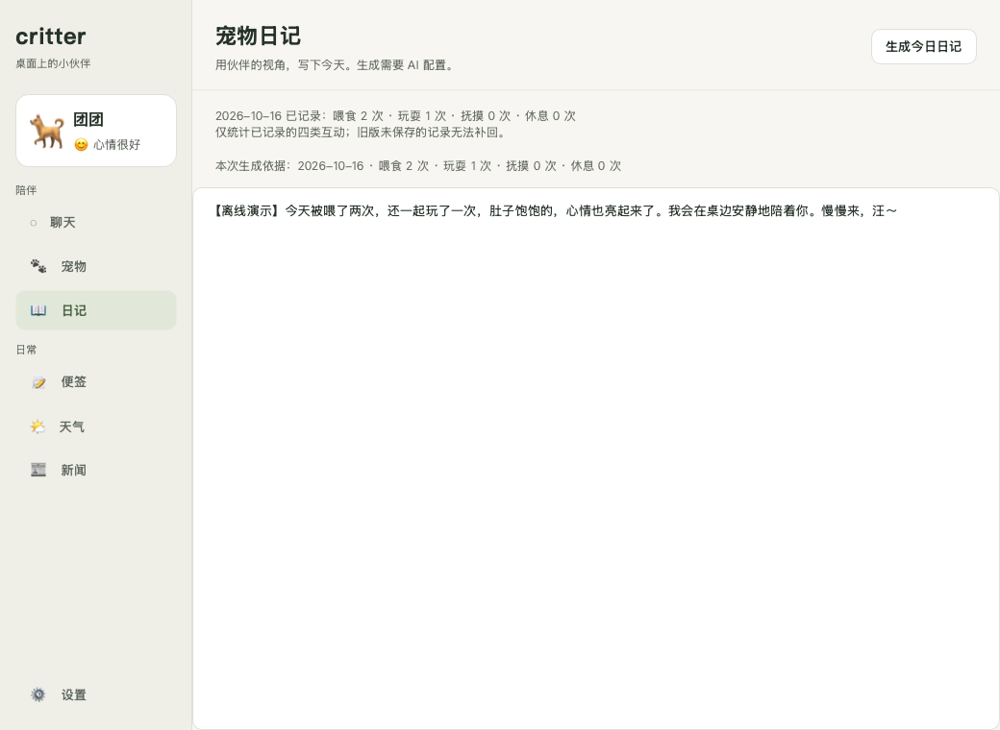

# 和桌边的团团过一小段日常

[返回首页](../README.md) · [配置 AI](configuration.md) · [使用与保存边界](usage-and-storage.md)

这组图录于 **2026-10-16**，运行包含聊天忙碌锁修复的 [`e28ff764`](https://github.com/xyma2003/critter/commit/e28ff764436761fe19299a070109bc7463209efc)。展示更新不改变聊天、互动、日记或动画的产品代码。

图片来自实际 `main.main()`、Qt 事件循环和控件的离屏渲染，不是用户桌面截图。对话使用合成输入和固定离线回复，文本内标有 **【离线演示】**；网络、真实模型与 CLI 调用被阻断。所有状态都保存在独立临时目录，没有读取个人聊天或便签。

## 1. 桌宠已经随项目一起住进来

这是实际宠物窗口的一帧，原始图片有透明背景。应用直接播放仓库中的 GIF，无需下载或生成素材。下面是同一套可分发资源里的摇尾动作：

GIF 是仓库素材预览，不是操作录屏。素材来源与许可见[基础边牧说明](../assets/animations/border_collie/README.md)。

## 2. 同一会话，接着说

演示把宠物命名为“团团”，使用两轮对话：

| 用户输入 | 固定模拟回复 |
| --- | --- |
| 【离线演示】我叫小林，今天在整理 GitHub 项目。 | 【离线演示】记住啦，小林。我们一个项目一个项目慢慢来。 |
| 【离线演示】我刚才在做什么？ | 【离线演示】你刚才在整理 GitHub 项目，我记着呢。 |

两轮都由真实 `OpenAIChatThread` 发起，仅 SDK 返回值替换为固定文本。验收捕获到第二次请求包含第一问、第一答和第二问，且第二问只出现一次。它验证了上下文传递，不能证明真实模型的记忆或回答质量。

等待时的发送保护、会话恢复、旧请求隔离及上下文长度限制见[连续聊天说明](usage-and-storage.md#连续聊天与人设)。

## 3. 喂两次，玩一次

在“宠物”页面实际点击 **喂食两次、玩耍一次**。状态条与互动记录随按钮操作更新，桌宠切换到对应动画。

这三次操作写入隔离的状态文件。没有把聊天次数当作喂食或玩耍，也没有预先填好互动统计。

## 4. 用这次记录生成日记

打开“日记”，检查当天计数和“本次生成依据”，再点击 **生成今日日记**。

真实 `DiaryWorker` 的请求中包含：**喂食 2、玩耍 1、抚摸 0、休息 0**。固定离线回复写到页面，并以 `kind=diary` 保存到便签；验收核对了正文与日期。画面中的日记是模拟文本，不能当作模型依据事实写作能力的证明。

## 自己试用

按[无密钥启动步骤](../README.md#开始使用)打开应用，即可体验桌宠、互动和便签。连续聊天与日记生成需另行[配置 AI](configuration.md)，真实回复会与本演示不同。

本次演示有 **16 条离线验收条件通过**，覆盖实际线程、上下文、动画、互动计数和日记保存。另在 macOS Cocoa 原生窗口验证了无凭据、空独立数据目录的启动：默认动画正常，主面板可显示，Agent 图可编译。完整交互验收采用上述 Qt 离屏流程；原生检查只确认启动，不代表已验证真实模型或外部服务。
